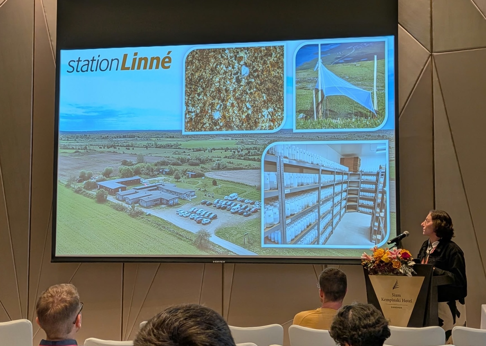
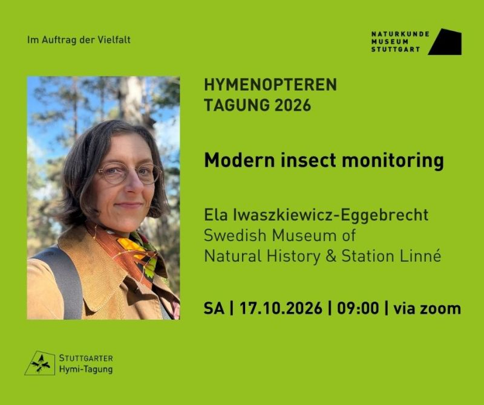

# News

### November 2026
Ela presented ongoing work at the International Barcode of Life Conference in Bangkok, Thailand. A highlight was our FAVIS protocol, a non-destructive method for DNA metabarcoding of insect bulk samples while preserving their morphology for further study.

Supported by micro-CT imaging, our results show that FAVIS causes minimal structural damage compared with conventional lysis methods. We were delighted by the strong interest in FAVIS and the opportunity to share our work with the international DNA barcoding community!

### October 2026

On 17 October, Ela gave a plenary talk at the Hymenoptera Days, organized by the State Museum of Natural History in Stuttgart. Her talk focused on DNA-based approaches to insect monitoring and their potential for biodiversity research.

Hymenoptera Days was an excellent meeting, featuring great selections of talks covering a wide range of topics. The event sparked inspiring discussions about the future of insect monitoring. Many thanks to the organizers for bringing the community together!

