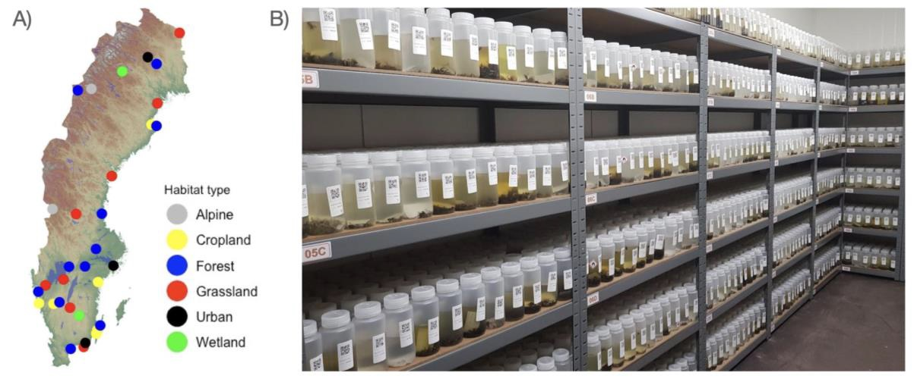

#  Monitoring Insect Biodiversity Through DNA

Insect populations are changing worldwide, with growing evidence of widespread declines in abundance and diversity. However, our understanding of these changes remains limited, as traditional monitoring methods are time-consuming and unable to capture the enormous diversity of insect species. This project aims to address these knowledge gaps by developing innovative approaches to monitor and understand long-term changes in insect communities across Sweden.

Using DNA metabarcoding techniques, it is possible to identify thousands of insect species from environmental samples more efficiently than through traditional identification methods. Building on the Insect Biome Atlas project [https://www.insectbiomeatlas.org/], this research combines DNA analysis with insect samples collected using Malaise traps at sites representing a wide range of Swedish habitats. By extending this monitoring effort through 2027, the project will establish an unprecedented eight-year dataset documenting insect diversity and changes over time.

Fig. 1. (A) Collecting sites targeted in the project are spread throughout Sweden and represent six distinct habitat types. (B) To preserve DNA, samples are stored in a dedicated freezer house at Station Linné at -20°C.

The collected data will be used to investigate trends in insect populations, species distributions, and community composition. The research will explore how different insect groups respond to environmental conditions and identify broader patterns of change, including those affecting species that are difficult to monitor individually. This approach will provide new insights into the structure and dynamics of insect communities at a national scale.

Ultimately, the project aims to improve our understanding of insect biodiversity and develop reliable, scalable methods for long-term biodiversity monitoring. By making data openly available and advancing methods for assessing conservation priorities, the research will provide an important scientific foundation for future conservation strategies and biodiversity monitoring initiatives in Sweden and internationally.

# Publications:
- Iwaszkiewicz-Eggebrecht E, Łukasik P, Buczek M, Deng J, Hartop EA, Havnås H, Prus-Frankowska M, Ugarph CR, Viteri P, Andersson AF, Roslin T, Tack AJM, Ronquist F, Miraldo A. 2023. FAVIS: Fast and versatile protocol for non-destructive metabarcoding of bulk insect samples. PLOS ONE 18, e0286272. [https://doi.org/10.1371/journal.pone.0286272]
- Iwaszkiewicz-Eggebrecht, E., Goodsell, R. M., Bengsson, B.-Å., Mutanen, M., Klinth, M., van Dijk, L. J. A., Łukasik, P., Miraldo, A., Andersson, A., Tack, A. J. M., Roslin, T., & Ronquist, F. (2025). High-throughput biodiversity surveying sheds new light on the brightest of insect taxa. Proceedings of the Royal Society B: Biological Sciences, 292(2046), 20242974. [https://doi.org/10.1098/rspb.2024.2974]
- Miraldo, A., Sundh, J., Iwaszkiewicz-Eggebrecht, E., Buczek, M., Goodsell, R., Johansson, H., Fisher, B. L., Raharinjanahary, D., Rajoelison, E. T., Ranaivo, C., Randrianandrasana, C., Rafanomezantsoa, J.-J., Manoharan, L., Granqvist, E., van Dijk, L. J. A., Alberg, L., Åhlén, D., Aspebo, M., Åström, S., … Ronquist, F. (2025). Data of the Insect Biome Atlas: A metabarcoding survey of the terrestrial arthropods of Sweden and Madagascar. Scientific Data, 12(1), 1–18. [https://doi.org/10.1038/s41597-025-05151-0]
-

